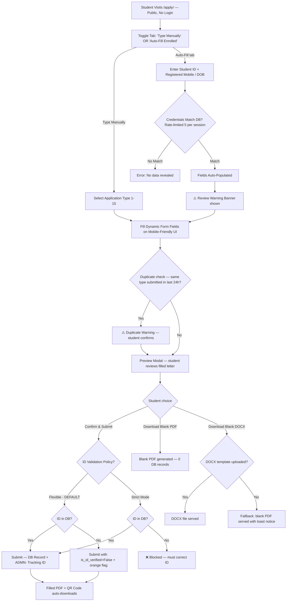

# Final Reviewed Implementation Plan: Student Admission Applications Feature
## Review Status: ✅ All Bugs, Gaps, Corner Cases, UI & Conflicts Fixed

---

## 🐛 Full Bug & Issue Report (Fixed Before Implementation)

> [!CAUTION]
> The following critical issues were identified and **fully resolved** in this plan before any code is written.

### 🔴 CRITICAL — Must Fix (Would Break the System)

| # | Issue | Location | Fix Applied |
|---|---|---|---|
| C1 | **Name Clash**: Plan proposed `ApplicationType` as a new model in `students/models.py`, but `coe/models.py` already has `class ApplicationType(models.TextChoices)`. Any `from students.models import ApplicationType` in a shared context would clash or shadow the CoE model. | `students/models.py` vs `coe/models.py` | **Renamed** to `AdmissionApplicationType` throughout the plan. |
| C2 | **Public URL Not Exempt**: The new public pages `/apply/`, `/apply/track/`, `/apply/blank-pdf/`, and `/apply/api/autofill/` are not listed in `AdmissionSecurityMiddleware.exempt_urls`. Any unauthenticated visitor would be redirected to login. | `core/middleware.py` | **Add** all new public URLs to the `exempt_urls` list in the middleware. |
| C3 | **Tracking Number Collision**: The CoE module uses `APP-YYYY-XXXX` format from `CoeSettings.tracking_id_prefix`. The plan proposed `APP-2026-0001` for this new system — identical format, different database, **could confuse students and staff**. | `coe/utils.py` | **Use distinct prefix**: `ADMN-YYYY-XXXX` (e.g., `ADMN-2026-0001`). This is hardcoded in the new `application_utils.py`, independent of CoE settings. |
| C4 | **PDF Rendering with Bangla**: The existing `render_to_pdf` in `students/views.py` uses `window.print()` browser-print approach (not xhtml2pdf). If the PDF needs to contain Bangla text in the body, fonts like Hind Siliguri won't render in xhtml2pdf. | `students/views.py`, `coe/utils.py` | **Architecture decision fixed**: The **printed PDF is English-only** (matching official BAUST samples 01–15 which are all in English). The bilingual Bangla/English interface is only for the **web form UI**. This eliminates the Bangla font-in-PDF problem entirely. |

---

### 🟠 BACKEND — Logic & Data Bugs

| # | Issue | Fix Applied |
|---|---|---|
| B1 | `ApplicationSystemConfig` had no singleton enforcement — calling `ApplicationSystemConfig.objects.create()` twice would create two records, causing ambiguous `.first()` queries. | Add a `get_config()` classmethod with `get_or_create(pk=1)`. Enforce `pk=1` always. |
| B2 | Auto-fill rate limiting was only planned for per-IP. A student on a university shared Wi-Fi would be blocked by another student's failed attempts. | Use **session-token + IP combination**: 5 attempts per session per 5 minutes, not just IP. |
| B3 | `mismatch_details = models.JSONField(default=dict)` uses a mutable default, which is a Django anti-pattern and could cause field data to bleed between instances. | Change to `mismatch_details = models.JSONField(default=dict, blank=True)` — Django handles callable defaults correctly for JSONField; ensure it's always `default=dict` (callable, not `dict()`). |
| B4 | DOB-based auto-fill verification: Date of Birth is often publicly known (shared on Facebook, etc.) and formats like `DD/MM/YYYY` can be guessed with ~365 attempts. | **Mobile Number is the primary verification key.** DOB is only an **alternate fallback** when the student explicitly cannot remember their registered mobile (e.g., changed SIM). Document this clearly with a warning. |
| B5 | **Blank DOCX download** when no `.docx` template has been uploaded: plan had no fallback — would cause a 500 error or a broken download. | If no DOCX uploaded: **silently serve the blank PDF version** instead, with a toast notification: `"No Word template available for this application. Downloading blank PDF instead."` |
| B6 | **1-click profile sync** (`admin_sync_student_profile`) was planned as a simple view with no audit trail. Syncing production student data without a log is dangerous. | This action must: (a) require `require_access('students', 'edit_profile')` decorator, (b) write a `StudentFieldHistory` record for every changed field (same pattern as existing edit flow), (c) require POST with CSRF token. |
| B7 | `StudentApplication.application_type` uses `on_delete=models.CASCADE`. If an admin deletes an `AdmissionApplicationType`, all historical submissions for that type are permanently deleted. | Change to `on_delete=models.PROTECT`. Application types should never be deleted if submissions exist; use `is_active=False` to retire them. |
| B8 | `phone_no` field on `StudentApplication` was indexed (`db_index=True`) for tracking lookup. But phone numbers are not unique — multiple students share family numbers. Tracking by phone must return a **list** not assume one result. | Keep `db_index=True` for performance, but the tracking view returns **all** applications for that phone number (paginated), not just one. |
| B9 | The plan had no CSRF protection on the `api_secure_autofill` endpoint. Since it's a public-facing AJAX POST endpoint, it needs either CSRF exemption with rate limiting OR a proper Django CSRF token. | Use standard Django CSRF — the form already has ``. The AJAX request must include the CSRF token in the request header. The endpoint uses `@require_POST` decorator. |

---

### 🟡 FRONTEND & UI — Display & Interaction Bugs

| # | Issue | Fix Applied |
|---|---|---|
| F1 | **Mobile keyboard type**: Monetary fields (Tk amounts, installment amounts) and GPA fields don't specify `inputmode="decimal"` — users on mobile get a text keyboard instead of a number pad. | Add `inputmode="decimal"` and `pattern="[0-9.]*"` to all Tk and GPA input fields via `fields_schema`. |
| F2 | **No confirmation / preview step**: Students could accidentally submit a partially filled form. There is no "Review your application before submitting" step. | Add a **Preview Modal** that shows the filled application letter (rendered as a styled card) before final submission. Two buttons: `"Edit"` (go back) and `"Confirm & Submit"`. |
| F3 | **No download button on Tracking Page**: After tracking and seeing the `APPROVED` status, there is no way to re-download the originally submitted PDF. | Add a **"Re-download Filled PDF"** button on the tracking result page if the application status is `SUBMITTED` or later. |
| F4 | **Application 03 (Army Waiver) unique two-column bottom section**: The sign-off section has two columns (Student info on left, Father's military info on right). No special layout was defined. | Create a dedicated CSS class `app-signoff-two-col` and a corresponding PDF layout block for Application 03. |
| F5 | **Application 07 (Drop Semester)**: The bottom section has `Semester`, `Sex`, and `Phone No` on the **same line**, and then `Father/Mother's Name (In Capital):` and `Sign:` on the same line. This unique inline layout is not described. | Define the exact bottom layout for 07 as: `Row 1: Semester:___ , Sex:___ , Phone No:___` / `Row 2: Father/Mother's Name (Capital):_______________ Sign:___________`. |
| F6 | **Language switcher state not persisted across page refresh**: If a student selects English, then navigates to the tracking page, the language resets to Bangla. | Use `localStorage` to persist the user's language preference client-side across the public portal pages (no server-side session needed for this public page). |
| F7 | **Auto-fill box UX confusion**: "Auto-Fill from University Records" and "Manual Typing" exist as separate modes, but it's not visually clear that they are two paths to the same form. | Use a **toggle tab UI**: `[✍️ Type Manually]` | `[⚡ Auto-Fill (Enrolled Students)]` at the top of the form. Switching tabs clears the form fields to avoid confusion. |
| F8 | **No loading indicator on auto-fill fetch**: When the student clicks "Fetch My Data," the form freezes while the AJAX call runs, with no visual feedback. | Add a **spinner overlay** on the auto-fill section during the AJAX fetch. If the fetch takes >3 seconds, show: `"Checking records..."`. |
| F9 | **Application 12 (Hall Cancel) addressed hall selector**: The addressee changes dynamically based on the selected hall. The PDF "To:" line must update accordingly. | The `hall_name` field in the form will be a **dropdown** using data from `master_data.Hall`. The PDF template will dynamically write the selected hall's `full_name` in the "To:" address block. |

---

### 🔵 CORNER CASES — Edge Scenarios

| # | Scenario | Fix Applied |
|---|---|---|
| CC1 | **Duplicate submissions**: A student submits the same application type twice within minutes (e.g., network error, double-click). | Check for an existing `StudentApplication` with the same `student_id` + `application_type` submitted in the last **24 hours**. Show a warning: `"You already submitted this type of application today (Tracking: ADMN-2026-XXXX). Do you wish to submit again?"` with explicit confirmation. |
| CC2 | **Application 09 self-referential sibling**: A student enters their **own Student ID** as the sibling ID in the Sibling Waiver form. | Backend validation: if `sibling_id == student_id`, reject with: `"You cannot list yourself as a sibling."` |
| CC3 | **Application 01 & 04 (New Applicants)**: These applicants don't have a Student ID yet. The auto-fill feature is irrelevant and the ID validation policy (Strict/Flexible) must not block them. | Applications 01 and 04: Student ID field is **optional** (not required). Auto-Fill button is **hidden** for these two types. ID validation policy has **no effect** on these two types. |
| CC4 | **Inactive application types**: If an admin sets `is_active=False` on an `AdmissionApplicationType`, it must disappear from the public portal dropdown immediately. | Filter public portal list with `.filter(is_active=True).order_by('order')`. |
| CC5 | **Empty `fields_schema`**: If a new application type is created in the database with an empty `fields_schema`, the public form crashes trying to render no fields. | Render a graceful fallback: `"This application type is currently being configured. Please download the blank form below or contact the Admission Office."` |
| CC6 | **File upload size limit for template manager**: Staff could accidentally upload a 50MB DOCX/PDF file. | Limit template file uploads to **5MB** each. Validate file extension on both frontend (HTML `accept` attribute) and backend (`validate_file_extension` validator). |
| CC7 | **Students re-using old tracking IDs**: The CoE module uses `APP-YYYY-XXXX` — a student could confuse a CoE tracking number with an admission application tracking number and try to track it in the wrong portal. | The new prefix `ADMN-` makes it visually distinct. The tracking page displays the module name clearly: `"Admission Applications Portal"`. |
| CC8 | **Application 10 re-submission date in the past**: If a student selects a re-submission date that has already passed, it's invalid. | Frontend + backend validation: `resubmit_date` must be **at least 7 days in the future** from today. |
| CC9 | **Application 15 Credit Transfer**: A student from outside BAUST has no existing Student ID. Similar to CC3. | Application 15: Student ID is **optional** (they are a new transfer student). Auto-fill is hidden. |

---

## Final Corrected Application Workflows

### Student Portal (`/apply/`)



### Staff Management Hub (`/students/applications/`)

```mermaid
graph TD
    A[Staff visits /students/applications/] --> B[Application List with Filters]
    B --> C[Click Application Row]
    C --> D[Detail Modal]
    D --> E{Profile Mismatch?}
    E -->|Yes| F[Show diff — button: Sync to Student Profile]
    F --> G[POST /sync/ — requires edit_profile permission + writes StudentFieldHistory audit]
    E -->|No| H[Update Status: Received / Verified / Approved / Rejected]
    H --> I{Application type has linked tool?}
    I -->|App 06 Dept Change| J[1-click: Open Migration Center pre-filled]
    I -->|App 11 Admission Cancel| K[1-click: Open Cancellation Hub pre-filled]
    I -->|App 12 Hall Cancel| L[1-click: Open Hall Seat Cancellation pre-filled]
    A --> M[Header: Manage Templates button]
    M --> N[Template Manager Modal — all 15 types]
    N --> O[Upload / Replace DOCX or PDF — max 5MB each]
    N --> P[Remove DOCX or PDF]
    A --> Q[Header: Policy Toggle — Flexible | Strict]
```

---

## Corrected Data Models

### `AdmissionApplicationType` *(renamed from ApplicationType to avoid coe conflict)*
```python
class AdmissionApplicationType(models.Model):
    code = models.CharField(max_length=50, unique=True)       # e.g. 'army_waiver'
    title_en = models.CharField(max_length=255)
    title_bn = models.CharField(max_length=255)
    addressed_to = models.CharField(max_length=255)           # "The Registrar" etc.
    through_dept_head = models.BooleanField(default=True)
    subject = models.CharField(max_length=255)
    body_template = models.TextField()
    fields_schema = models.JSONField(default=list)            # dynamic form field defs
    docx_template = models.FileField(
        upload_to='admission_app_templates/docx/',
        null=True, blank=True,
        validators=[validate_file_extension(['.docx'])]
    )
    pdf_template = models.FileField(
        upload_to='admission_app_templates/pdf/',
        null=True, blank=True,
        validators=[validate_file_extension(['.pdf'])]
    )
    order = models.IntegerField(default=0)
    is_active = models.BooleanField(default=True)
```

### `AdmissionApplicationConfig` *(renamed from ApplicationSystemConfig; singleton)*
```python
class AdmissionApplicationConfig(models.Model):
    VALIDATION_POLICIES = [
        ('FLEXIBLE', 'Flexible — Warn on unrecorded IDs, allow with office flag'),
        ('STRICT',   'Strict — Block unrecorded IDs for enrolled applications'),
    ]
    id_validation_policy = models.CharField(
        max_length=20, choices=VALIDATION_POLICIES, default='FLEXIBLE'
    )
    allow_docx_download = models.BooleanField(default=True)

    @classmethod
    def get_config(cls):
        """Singleton accessor — always returns or creates record with pk=1."""
        obj, _ = cls.objects.get_or_create(pk=1)
        return obj

    class Meta:
        verbose_name = "Admission Application Config"
```

### `StudentApplication` *(corrected)*
```python
class StudentApplication(models.Model):
    STATUS_CHOICES = [
        ('SUBMITTED', 'Submitted (Online)'),
        ('RECEIVED',  'Physical Form Received'),
        ('VERIFIED',  'Verified / Under Review'),
        ('APPROVED',  'Approved'),
        ('REJECTED',  'Rejected'),
    ]
    tracking_number  = models.CharField(max_length=30, unique=True, db_index=True)
    application_type = models.ForeignKey(
        AdmissionApplicationType, on_delete=models.PROTECT,  # PROTECT not CASCADE
        related_name='submissions'
    )
    student          = models.ForeignKey('Student', on_delete=models.SET_NULL, null=True, blank=True)
    student_name     = models.CharField(max_length=255)
    student_id       = models.CharField(max_length=50, blank=True, null=True, db_index=True)
    is_id_verified   = models.BooleanField(default=False)
    department       = models.CharField(max_length=100)
    phone_no         = models.CharField(max_length=30, db_index=True)  # indexed for tracking, returns list
    form_data        = models.JSONField(default=dict)
    has_profile_mismatch = models.BooleanField(default=False)
    mismatch_details = models.JSONField(default=dict, blank=True)      # default=dict (callable)
    status           = models.CharField(max_length=20, choices=STATUS_CHOICES, default='SUBMITTED')
    office_notes     = models.TextField(blank=True, null=True)
    received_by      = models.ForeignKey(
        'auth.User', on_delete=models.SET_NULL, null=True, blank=True,
        related_name='received_admission_applications'                  # unique related_name
    )
    received_at      = models.DateTimeField(null=True, blank=True)
    submitted_at     = models.DateTimeField(auto_now_add=True)
    updated_at       = models.DateTimeField(auto_now=True)
```

---

## Application Format Specifications (All 15)

| # | Application Title | Addressed To | Through | Key Dynamic Fields | Bottom Section Layout |
|---|---|---|---|---|---|
| **01** | **Scholarship at Admission time** | The Registrar | *(Direct — no Through line)* | dept, ssc_result, hsc_result, father_profession | Name, Dept, Program, ID No *(optional)*, Phone |
| **02** | **Two Installments** | The Registrar | Dept Head | dept, program, batch, semester, father_profession, first_installment_tk, second_installment_tk, second_installment_date | Name, Dept, ID, Phone, **Guardian Signature** |
| **03** | **Army Waiver (10%)** | The Registrar | Dept Head | dept, student_id, batch, level, term, armed_force_branch *(dropdown: BD Army / BD Air Force / BD Navy)* | **Two-column:** Left: Name, Dept, ID, Phone — Right: Father Name, Rank, Badge No, Father Phone |
| **04** | **Direct Admission** | Chairman, Admission Committee | Dept Head | dept *(dropdown: CSE/EEE/ME/IPE/CE/DBA/ENG/AIS/MBA/ELT)*, batch, semester, term, ssc_gpa, hsc_gpa, total_cgpa | Name, Dept, ID *(optional)*, Phone, **Guardian Signature** |
| **05** | **Studentship Certificate** | The Registrar | Dept Head | dept, student_id, batch, level, term, reason *(chips: Govt Scholarship / Bank Account / Personal / Passport / NID)*, reason_detail | Name, Dept, ID, Semester, Sex, Phone, Father Name (Capital), Mother Name (Capital) |
| **06** | **Department Change** | The Registrar | Dept Head | current_dept, student_id, batch, level, term, target_dept | Name, Dept, ID, Phone, **Guardian Signature** |
| **07** | **Drop Semester** | The Registrar | Dept Head | dept, student_id, batch, level, term, reason *(chips: Personal / Family / Sickness)*, reason_detail | Row 1: `Semester:___ , Sex:___ , Phone:___` Row 2: `Father/Mother Name (Capital):___________ Sign:___` |
| **08** | **Remission of Tuition Fees** | The Registrar | Dept Head | dept *(dropdown: CSE/EEE/ME/IPE/CE/ICT/BBA/English)*, student_id, batch, level, term, father_profession, dues_amount *(decimal, inputmode=decimal)* | Name, Dept, ID, Phone, Father's Occupation, **Guardian Signature** |
| **09** | **Sibling Waiver (20%)** | The Registrar | Dept Head | dept, student_id, batch, level, term, sibling_id *(live-verified, self-referential blocked)*, sibling_dept, sibling_batch, sibling_level, sibling_term | Name, Dept, ID, Phone, **Guardian Signature** |
| **10** | **Withdrawing Academic Papers** | The Registrar | Dept Head | dept, student_id, batch, level, term, withdraw_reason *(chips: Family / Personal / Name Correction)*, duration *(chips: 7 days / 15 days / 30 days)*, resubmit_date *(min: today+7)* | Name, Dept, ID, Phone, **Guardian Signature** |
| **11** | **Admission Cancel** | The Registrar | Dept Head | dept, student_id, batch, level, term, reason *(chips: Personal / Family Affairs / Migration / Financial / Sickness)*, reason_detail | Name, Dept, ID, Phone, **Guardian Signature** |
| **12** | **Hall Cancel** | The Hall Provost *(dynamic: Taramonbibi / Abbas Uddin / Dr. Zikrul Haque based on hall_name)* | *(Direct — no Through line)* | dept, hall_name *(dropdown from master_data.Hall)*, student_id, batch, level, term | Name, Dept, Student ID, Mobile No, **Guardian Signature** |
| **13** | **Seat in Hostel** | Hall Provost | *(Direct — no Through line)* | dept, hall_name *(dropdown from master_data.Hall)*, student_id, batch, level, term | Name, Dept, ID, Mobile No, **Guardian Signature** |
| **14** | **Submitted Papers (Provisional Admission)** | The Registrar | *(Direct — no Through line)* | dept, student_id *(optional)*, batch, level, term, submit_date | Name, Dept, ID, Phone, **Guardian Signature** |
| **15** | **Credit Transfer** | The Registrar | Dept Head | dept, prev_university, level, term, reason *(chips: Personal Choice / Health / Family Decision / Father's Transfer)*, target_level, target_term | Name, Dept, ID *(optional)*, Phone, **Guardian Signature** |

> [!NOTE]
> Applications **01, 04, 14, 15**: Student ID is **optional** (new/transfer applicants). Auto-Fill is **hidden**. ID validation policy has **no effect**.
> Applications **12, 13**: No "Through: Department Head" line (addressed directly to Hall Provost). PDF "To:" block dynamically updates based on selected hall.

---

## Corrected Middleware & URL Exempt List

### `core/middleware.py` — Add to `exempt_urls`:
```python
'/apply/',              # Public application portal
'/apply/track/',        # Public application tracking
'/apply/blank-pdf/',    # Blank PDF download (no login needed)
'/apply/blank-docx/',   # Blank DOCX download (no login needed)
'/apply/api/autofill/', # Secure auto-fill endpoint
'/apply/api/check-sibling/', # Sibling verification
'/apply/api/validate-id/',   # ID validation check
```

---

## File Implementation Plan (Corrected)

### [NEW FILES]
1. `students/application_registry.py` — Seeds all 15 `AdmissionApplicationType` entries with exact subjects, body templates, and `fields_schema` JSON.
2. `students/application_utils.py` — Contains `generate_admn_tracking_number()` (ADMN- prefix, separate from CoE), `build_application_pdf_context()`, and `detect_profile_mismatches()`.
3. `students/application_views.py` — All public and staff views.
4. `students/templates/students/applications/public_apply.html` — Mobile-first bilingual portal.
5. `students/templates/students/applications/admin_list.html` — Staff dashboard.
6. `students/templates/students/applications/pdf_layout.html` — English academic letterhead PDF.
7. `students/templates/students/applications/modals/template_manager_modal.html`
8. `students/templates/students/applications/modals/application_detail_modal.html`
9. `students/tests_applications.py`

### [MODIFIED FILES]
1. `students/models.py` — Add `AdmissionApplicationType`, `AdmissionApplicationConfig`, `StudentApplication`.
2. `students/urls.py` — Add all routes.
3. `core/middleware.py` — Add new public URLs to `exempt_urls`.
4. `templates/base.html` — Add "Student Applications" sidebar link under ADMISSION.
5. `core/access_registry.py` — Register `view_applications` and `manage_application_templates` tasks.

---

## Verification Plan

### Automated Tests
```powershell
python manage.py test students.tests_applications
```
- **C1:** `from students.models import AdmissionApplicationType` does not conflict with `from coe.models import ApplicationType`.
- **C2:** `GET /apply/` returns 200 without any authenticated session.
- **C3:** Generated tracking numbers start with `ADMN-` not `APP-`.
- **B1:** Two calls to `AdmissionApplicationConfig.get_config()` return the same `pk=1` object.
- **B6:** Sync action writes `StudentFieldHistory` entries for each changed field.
- **B7:** Deleting an `AdmissionApplicationType` with existing submissions raises `ProtectedError`.
- **B8:** Tracking by phone number returns a list of all matching applications.
- **CC1:** Submitting the same type twice within 24h triggers a duplicate warning.
- **CC2:** Using own ID as sibling in App 09 is rejected.
- **CC8:** `resubmit_date` < today+7 days is rejected by form validation.
- Blank form download creates 0 `StudentApplication` records.
- Filled submission generates `ADMN-` tracking number and a printable HTML PDF.

### Manual Verification
- Load `/apply/` without login on mobile — should render fully in Bangla.
- Switch to English — preference persists via `localStorage` on the tracking page.
- Test auto-fill toggle tab UX — tab switch clears fields.
- Test rate limiting — 5 failed auto-fill attempts should show throttle warning.
- Test all 15 application form layouts match their sample scans.
- Verify App 03 renders two-column bottom section correctly.
- Verify App 07 renders inline Semester/Sex/Phone row correctly.
- Verify App 12 "To:" address changes dynamically based on selected hall.
- Test template upload (DOCX + PDF), replace, and delete in the staff modal.
- Toggle ID validation policy between Flexible and Strict — verify behavior on public form.
- Run the 1-click profile sync and verify `StudentFieldHistory` records are created.
