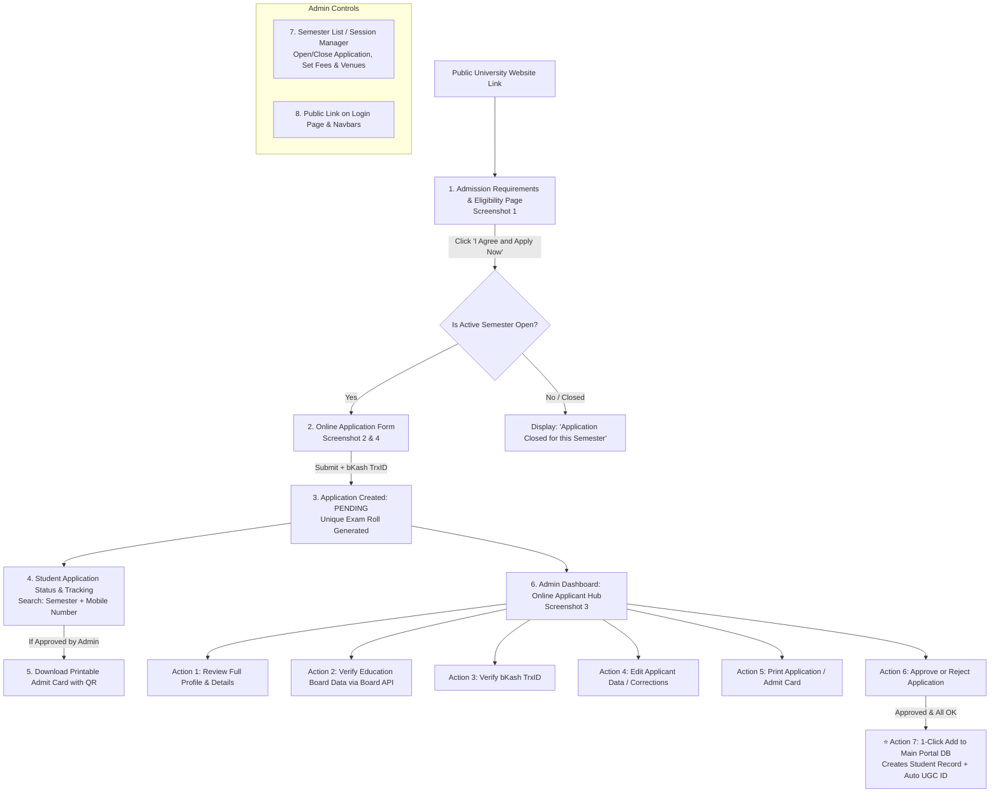

# Full Bug-Reviewed Implementation Plan: Student Public Online Admission System
## Review Status: ✅ All Bugs, Gaps, Corner Cases, UI & Conflicts Fixed Before Implementation

---

## 🐛 Full Bug & Issue Report (Fixed Before Any Code is Written)

> [!CAUTION]
> The following issues were identified by deep analysis of the existing codebase. All are **fully resolved** in this plan.

### 🔴 CRITICAL — Would Break the System

| # | Issue | Location | Fix Applied |
|---|---|---|---|
| C1 | **URL Namespace Conflict**: Plan proposed `/admission/` as the public requirements page URL, but the `apply/` path was already exempted in `AdmissionSecurityMiddleware`. Using a separate `/admission/` URL prefix would need its own middleware exemption and a new URL include, breaking routing if carelessly placed. | `core/middleware.py`, `admission_system/urls.py` | **Use `/admission-portal/` as the prefix** for all new public pages. Add `/admission-portal/` to middleware `exempt_urls`. All new public URLs go under `students/urls.py` since the `students` app already includes all student-related URLs. |
| C2 | **`is_engineering` field semantics**: Queried DB shows `Cluster.is_engineering` is set to `True` for ALL clusters including `Business` and `Arts`. This means the plan's assumption that `Program.cluster.is_engineering` can distinguish Engineering vs Non-Engineering programs is WRONG — it cannot be used for that purpose. | `master_data/models.py`, DB state | **Use `Cluster.name` to determine category**: Engineering programs belong to `cluster.name == 'Engineering & Technology'`. BBA/AIS belong to `cluster.name == 'Business'`. English/MA belong to `cluster.name == 'Arts'`. In the `OnlineApplicant` model, store `program_category` as a `CharField` with values `'Engineering'` or `'Non Engineering'` chosen by the applicant, not derived from `Cluster.is_engineering`. |
| C3 | **`mother_occupation` missing from Student model**: The plan proposed copying `mother_occupation` to the `Student` record during 1-click enrollment. Inspecting the actual `Student` model shows it has `father_occupation` but NO `mother_occupation` field. | `students/models.py` | **Do NOT add `mother_occupation` to `OnlineApplicant → Student` copy**. The `OnlineApplicant` model stores `mother_occupation` for the application record only. During enrollment, copy only fields that exist in `Student`: `father_name`, `father_occupation`, `father_mobile`, `mother_name`, `mother_mobile` (no `mother_occupation` copy). |
| C4 | **Photo storage architecture mismatch**: The `Student` model uses `photo_path = CharField(max_length=255)` (a plain string path), not a Django `ImageField`. The plan proposed using `ImageField` on `OnlineApplicant`. When enrolling, copying from `ImageField` to `photo_path` (CharFiield) requires converting the file path to a string manually. | `students/models.py` line 169 | **Keep `OnlineApplicant.photo` as `ImageField`** (since `Pillow==11.2.1` is in requirements). During enrollment copy, write the applicant photo file to `media/students/photos/{student_id}.jpg` using Pillow or shutil, and save the relative path string to `Student.photo_path`. |
| C5 | **Exam Roll number race condition**: The `next_roll_number` field on `AdmissionSemester` would cause race conditions under concurrent submissions since two requests can read the same value simultaneously and generate duplicate rolls. | `AdmissionSemester` model | **Use `select_for_update()` + `F()` expressions or an atomic increment** (same pattern as existing `generate_admn_tracking_number()` in `application_utils.py`). Generate exam roll atomically: lock the semester row, read current `next_roll_number`, increment it, save — all in one transaction. |
| C6 | **Duplicate application submission**: A student can submit multiple applications for the same semester by refreshing the form or clicking submit twice. The original plan had no per-student-per-semester duplicate check. | `OnlineApplicant` model | **Add a database-level unique constraint**: `UniqueConstraint(fields=['semester', 'mobile'], condition=Q(is_trashed=False), name='unique_active_application_per_mobile_per_semester')`. Additionally add a 24-hour frontend rate limit check on the `mobile` + `semester` combination before allowing the form to load. |
| C7 | **Login page tile already exists**: The `login.html` already has a `"Student Admissions"` tile linking to `/apply/` (existing internal applications portal). The plan risks creating a second, conflicting tile or breaking the existing link. | `templates/core/login.html` line 668–686 | **Modify the existing tile** — do NOT add a second tile. Update the existing `tile-admissions` tile description and add a third link `"Requirements"` pointing to `/admission-portal/` alongside the existing "Apply Now" and "Track" links. The existing links (`/apply/` and `/apply/track/`) remain unchanged. |
| C8 | **`AdmissionSemester` name clash with `master_data.Semester`**: The plan introduces `AdmissionSemester` in `students/models.py`. The existing system already uses `master_data.Semester` (for internal semester codes like 'Fall', 'Spring', 'Winter'). Two models named `*Semester` in different apps will cause confusion in imports and admin. | `students/models.py` vs `master_data/models.py` | **Rename to `AdmissionIntake`** to be unambiguous and semantically distinct. An "intake" is a specific admission event (e.g. "Winter 2027 Intake") while a "semester" is an academic period. This avoids all confusion. |

---

### 🟠 BACKEND — Logic & Data Bugs

| # | Issue | Fix Applied |
|---|---|---|
| B1 | **SSC/HSC Registration Number gap**: `Student` model has `ssc_reg` and `hsc_reg` fields. The initial plan's `OnlineApplicant` model did NOT include registration number fields, so enrollment would lose these values. | Add `ssc_reg` and `hsc_reg` `CharField` fields to `OnlineApplicant`. Include them in the enrollment copy. |
| B2 | **1-click enrollment must copy `semester_name`** from the intake, not leave it blank on `Student`. The `Student.semester_name` drives UGC ID generation. If empty, the ID generator falls back to semester code `"1"` (incorrect). | During enrollment, set `Student.semester_name` from `applicant.intake.name` (e.g. `"Winter 2027"`). Also set `admission_year` from `intake.academic_year.year`. |
| B3 | **`generate_next_ugc_id()` signature requires `admission_year`, `semester_name`, `hall_name`, `program_name`, `cluster_name`, `program_level`** — all 6 parameters. The enrollment modal must collect `hall_name` from admin (which hall the student is assigned to) since applicants do NOT pre-select a hall. | The enrollment modal must include a **Hall Assignment** dropdown (from `master_data.Hall`) and a **Batch Name** input. These are pre-enrollment decisions made by the admin, not the student. |
| B4 | **Soft delete + unique constraint interaction**: `UniqueConstraint` with `condition=Q(is_trashed=False)` on `(semester, mobile)` allows a trashed applicant to re-apply in the same semester. However, if admin restores a trashed record after a new application was submitted, there will be two active records. | **Add a reactivation guard**: when restoring a trashed applicant, check if another active application exists for the same `(semester, mobile)` and show an error instead of silently restoring. |
| B5 | **Payment verification has no audit trail**: The plan described an admin toggling payment status but didn't specify that the staff member's identity, timestamp, and any notes should be saved. | Add to `OnlineApplicant`: `payment_notes` TextField, `payment_verified_by` ForeignKey(User), `payment_verified_at` DateTimeField. All three must be populated atomically in the payment verification view. |
| B6 | **No SMS module code for online admission**: `SMSHistory.MODULE_CHOICES` has `'ADMISSION'` but this is used for enrolled students. The new online admission applicant SMS is a different context. | Use `module='ADMISSION'` with `use_case_event='online_application_confirm'` and `use_case_event='online_application_status_change'` — this aligns with the existing `SMSHistory` schema without modifying it. |
| B7 | **Admit card download access control**: The plan proposed open access (no login) to admit card by Exam Roll. A bad actor could enumerate rolls and download all candidates' photos and personal info. | **Require BOTH Exam Roll AND Mobile Number** to download an admit card. This is a two-factor lookup: `applicant = OnlineApplicant.objects.get(exam_roll=roll, mobile=mobile, status__in=['APPROVED', 'ADMITTED'])`. If no match, return a generic error without revealing whether the roll or mobile is wrong. |
| B8 | **Academic year linkage**: `AdmissionIntake` has `academic_year = ForeignKey('master_data.AdmissionYear')` but `master_data.AdmissionYear` only has a `year` integer. The semester name ("Winter 2027") must be stored independently since it combines `Semester.name` + year. | Store `intake_name = CharField(max_length=100)` directly (e.g. `"Winter 2027"`) on `AdmissionIntake` as the primary display name. Also keep `academic_year` FK as optional for reporting links. The student enrollment copies `intake_name` → `Student.semester_name`. |
| B9 | **No enrollment guard**: If admin clicks "Add to Portal DB" twice, two `Student` records could be created from the same applicant. | Before enrollment: check `OnlineApplicant.admitted_student` — if it's not null, return an error: `"This applicant has already been enrolled as Student ID {admitted_student.student_id}."` Additionally, wrap the entire enrollment in `transaction.atomic()`. |

---

### 🟡 FRONTEND & UI — Display & Interaction Bugs

| # | Issue | Fix Applied |
|---|---|---|
| F1 | **Mobile keyboard types missing**: GPA fields need `inputmode="decimal"` and TrxID field needs `inputmode="text"` and `pattern="[A-Za-z0-9]+"`. Mobile number field needs `inputmode="tel"` and `type="tel"`. | All form inputs in the apply form will use explicit `inputmode` and `type` attributes. |
| F2 | **"Same as Present" address checkbox client JS**: When unchecked, permanent address fields should revert to blank (not retain copied values). A simple JS listener must track the original values before the copy. | The `same_as_present` checkbox JS will: (a) on check → copy all present fields to permanent fields and **disable** permanent inputs; (b) on uncheck → clear permanent fields and **re-enable** them. |
| F3 | **Form section progress indicator**: A 6-section form (like Screenshot 2) without progress feedback will confuse mobile users who don't know how far they are. | Add a sticky top progress bar showing `1/6 → 6/6` section labels. Each card section is visible sequentially on small screens (collapsible on desktop). |
| F4 | **Photo preview and validation**: The plan mentions 300x300px and 300KB limit but the current screenshot shows the validation hint box on the right side. No JS validation was specified. | Client-side JS: on file select, check `file.size <= 300*1024` and use `FileReader` + `Image` object to check dimensions. Block submission if either fails and show inline error under the upload field. |
| F5 | **No confirmation page after submission**: After clicking Submit, the applicant sees nothing. They need a printable confirmation receipt. | After successful submission, redirect to `/admission-portal/confirmation/<exam_roll>/` showing: Exam Roll, Application No., Name, Program, Semester, Applied Date, and a `[Print Confirmation]` button. This page is accessible without login by Exam Roll (no personal data exposed beyond what the student already submitted). |
| F6 | **Closed semester messaging on apply form**: If a student directly navigates to `/admission-portal/apply/` when all intakes are closed, they see an empty semester dropdown and can still try to submit. | On GET request to the apply form, if no `AdmissionIntake` with `is_open_for_application=True` and `application_deadline >= now()` exists, **redirect** to the requirements page `/admission-portal/` which shows the closed banner. Do NOT render the empty form. |
| F7 | **Admit card CSS print mode**: The plan used `window.print()` like the existing studentship certificate. However, the admin sidebar and header must be hidden for print. | Use `@media print { .main-header, .main-sidebar, .main-footer { display: none; } .content-wrapper { margin-left: 0; } }` in the admit card template's `<style>` block, identical to how the existing `pdf_layout.html` handles it. |
| F8 | **Admin table "Photo" column — 500 error risk**: If `applicant.photo` is blank (some applicants may skip), the template rendering `` will raise a `ValueError`. | In the template, always guard: `...` Never call `.url` on an empty `ImageField`. |
| F9 | **Applicant list pagination vs. page-size selector**: Screenshot 3 shows `Page Size: 20` and `Page No: 1 of 4`, plus a `Next >` button. The standard Django `Paginator` doesn't support dynamic page sizes from the GET param without extra code. | The admin list view reads `page_size = int(request.GET.get('page_size', 20))` and clamps it to `[10, 20, 50, 100]` to prevent DoS via `page_size=999999`. |
| F10 | **Board verification in admin context**: The existing `api_verify_board_result` view at `students` uses `@require_access('students', 'academic_audit')`. But the new online applicant board check is a separate action that should use `'manage_online_applicants'`. | Create a new dedicated API endpoint `api_verify_applicant_board_result` under `students/online_applicant_views.py` that uses `@require_access('students', 'manage_online_applicants')` and accepts an `applicant_id` instead of `student_id`. Internally it reuses the same `BoardVerificationEngine`. |

---

### 🔵 CORNER CASES — Edge Scenarios

| # | Scenario | Fix Applied |
|---|---|---|
| CC1 | **Multiple open intakes**: If admin accidentally opens two intakes at the same time, the "Apply Now" form will show two semesters in the dropdown. A student may choose the wrong one. | The public apply form shows a dropdown of ALL open intakes sorted by date. Add a clear label: `"Note: You are applying for the highlighted active semester."` Mark the most recently added one as "(Latest)" but allow both. |
| CC2 | **Intake deadline auto-close**: Admin must manually close intakes. If admin forgets, applications can come in after the exam. | In the `is_open_for_application` check, also compare `now() <= application_deadline` (if deadline is set). If deadline has passed, treat intake as closed regardless of the toggle. Show a warning in admin: `"This intake's deadline has passed but it is still manually marked as Open."` |
| CC3 | **Exam Roll prefix uniqueness**: If Engineering and Non-Engineering share a prefix (e.g. both use `"BAUST-"`) or if admin sets the same prefix twice, rolls will collide. | The `next_roll_number` on `AdmissionIntake` is global for that intake, not split by category. The prefix is stored per-intake (e.g. `"BAUST-Winter2027-"`) and the sequential number makes each roll unique within the intake. Admin is warned if duplicate rolls are detected. |
| CC4 | **Mobile number format variations**: Bangladesh mobile numbers can appear as `01711...`, `+8801711...`, or `881711...`. If the applicant enters `+8801711...` and later tracks with `01711...`, the search may fail. | **Normalize mobile numbers** on save: strip `+88`, `88`, leading spaces, and dashes. Store always in `01XXXXXXXXX` format (11 digits). Apply this normalization in both the submit view and the tracking search. |
| CC5 | **SSC/HSC GPA range validation**: A student could enter GPA `7.5` (out of 5.0 scale). No validation was specified. | Frontend + backend: validate GPA in range `0.00 – 5.00` with 2 decimal precision. Show inline error: `"GPA must be between 0 and 5."` |
| CC6 | **Enrollment with no active `master_data.AdmissionYear`**: `generate_next_ugc_id()` requires a year. If no `AdmissionYear` matches the intake year, the ID generator falls back silently. | Before enrollment, check that `AdmissionYear.objects.filter(year=intake_year).exists()`. If not, show admin error: `"Admission Year {year} is not configured in Master Data. Please add it before enrolling."` |
| CC7 | **Simultaneous double-enrollment click**: Admin double-clicks "Enroll" → two requests arrive at the server nearly simultaneously. Despite `admitted_student` check, both could pass the check before either saves. | Wrap in `select_for_update()` on the `OnlineApplicant` row within `transaction.atomic()`. The second request will block on the row lock until the first commits, then see `admitted_student != None` and abort. |
| CC8 | **Public page performance with large applicant tables**: The admin list may accumulate thousands of records over multiple semesters. No index on `is_trashed` + `semester_id`. | Add `db_index=True` to `is_trashed` and ensure the semester FK has its default index. The list view filters always include `is_trashed=False` (or `True`) and filters always include a semester selection by default (default = most recent intake). |
| CC9 | **Photo upload security — file type spoofing**: A malicious user could rename an `.exe` to `.jpg` and upload it. Plan relied on extension check only. | Use Pillow's `Image.open()` to attempt image verification server-side. If it raises an exception, reject the file as invalid. Also set `upload_to` to include a UUID filename to prevent path traversal attacks. |
| CC10 | **Admit card before payment verification**: A student might check status before admin verifies payment and see `PENDING` but still try to download an admit card. | The status page shows `[Download Admit Card]` ONLY if `status == 'APPROVED'` or `status == 'ADMITTED'`. For `PENDING` or `VERIFIED` status, show a contextual message: `"Your application is being reviewed. Admit card will be available after approval."` |

---

## Final Architecture: URL Structure

All public URLs go under `/admission-portal/` prefix, added to `students/urls.py` and exempted in middleware:

| URL | View | Description |
|---|---|---|
| `/admission-portal/` | `public_requirements` | Requirements & Eligibility Page |
| `/admission-portal/apply/` | `public_apply_form` | Online Application Form |
| `/admission-portal/confirmation/<str:exam_roll>/` | `public_confirmation` | Post-submission confirmation & receipt |
| `/admission-portal/status/` | `public_application_status` | Status tracking by Semester + Mobile |
| `/admission-portal/admitcard/` | `public_admitcard_download` | Admit card download (Roll + Mobile required) |
| `/admission-portal/api/check-open/` | `api_check_open_intakes` | AJAX: check if any intake is open |
| `/students/online-applicants/` | `admin_online_applicant_list` | Admin: Applicant Hub (Screenshot 3) |
| `/students/online-applicants/<int:pk>/detail/` | `admin_applicant_detail_modal` | Admin: Full detail modal |
| `/students/online-applicants/<int:pk>/update-status/` | `admin_update_applicant_status` | Admin: Update status (POST) |
| `/students/online-applicants/<int:pk>/verify-payment/` | `admin_verify_payment` | Admin: Verify bKash TrxID (POST) |
| `/students/online-applicants/<int:pk>/verify-board/` | `api_verify_applicant_board_result` | Admin: Board verification AJAX (POST) |
| `/students/online-applicants/<int:pk>/edit/` | `admin_edit_applicant` | Admin: Edit applicant data modal |
| `/students/online-applicants/<int:pk>/print/` | `admin_print_application` | Admin: Print application summary |
| `/students/online-applicants/<int:pk>/enroll/` | `admin_enroll_to_database` | Admin: 1-click enroll to Student DB (POST) |
| `/students/online-applicants/<int:pk>/trash/` | `admin_trash_applicant` | Admin: Soft delete (POST) |
| `/students/online-applicants/<int:pk>/restore/` | `admin_restore_applicant` | Admin: Restore trashed applicant (POST) |
| `/students/admission-intakes/` | `admin_intake_list` | Admin: Intake/Semester Manager |
| `/students/admission-intakes/add/` | `admin_intake_add` | Admin: Add new intake |
| `/students/admission-intakes/<int:pk>/edit/` | `admin_intake_edit` | Admin: Edit intake settings |
| `/students/admission-intakes/<int:pk>/toggle/` | `admin_intake_toggle` | Admin: Open/close intake (POST) |
| `/students/online-applicants/export/` | `admin_export_applicants` | Admin: Export to Excel (POST) |

**New middleware exemptions** to add to `core/middleware.py`:
```python
'/admission-portal/',   # entire prefix
```

---

## Corrected Data Models

### 1. `AdmissionIntake` *(new model in `students/models.py`)*

```python
class AdmissionIntake(models.Model):
    """Represents one admission event (e.g. 'Winter 2027 Intake')."""
    intake_name = models.CharField(
        max_length=100, unique=True,
        help_text="e.g. 'Winter 2027', 'Summer 2027'"
    )
    academic_year = models.ForeignKey(
        'master_data.AdmissionYear', on_delete=models.PROTECT,
        null=True, blank=True
    )
    is_open_for_application = models.BooleanField(
        default=True,
        help_text="Toggle to manually open or close applications"
    )
    application_deadline = models.DateTimeField(
        null=True, blank=True,
        help_text="If set, applications auto-close after this datetime"
    )
    exam_date = models.DateTimeField(
        null=True, blank=True,
        help_text="Admission test date & time"
    )
    exam_venue = models.CharField(
        max_length=255, default="BAUST Campus (Saidpur)"
    )
    
    # Financial settings (displayed dynamically on apply form)
    form_fee_bdt = models.DecimalField(
        max_digits=10, decimal_places=2, default=750.00
    )
    bkash_charge_bdt = models.DecimalField(
        max_digits=10, decimal_places=2, default=12.00
    )
    bkash_number = models.CharField(
        max_length=30, default="01769675556"
    )
    
    # Exam Roll generation
    exam_roll_prefix = models.CharField(
        max_length=50, default="BAUST-",
        help_text="e.g. 'BAUST-Winter2027-' or 'BAUST-'"
    )
    next_roll_number = models.IntegerField(
        default=1001,
        help_text="Auto-incremented atomically on each submission"
    )
    
    # Admin notice for public requirements page
    notice_html = models.TextField(
        blank=True, null=True,
        help_text="Optional HTML notice displayed on public requirements page"
    )
    
    created_at = models.DateTimeField(auto_now_add=True)
    updated_at = models.DateTimeField(auto_now=True)

    @property
    def total_fee_bdt(self):
        return self.form_fee_bdt + self.bkash_charge_bdt
    
    @property
    def is_currently_open(self):
        """True only if manually open AND deadline has not passed."""
        if not self.is_open_for_application:
            return False
        if self.application_deadline and timezone.now() > self.application_deadline:
            return False
        return True

    class Meta:
        ordering = ['-id']
        verbose_name = "Admission Intake"
        verbose_name_plural = "Admission Intakes"
    
    def __str__(self):
        return self.intake_name
```

### 2. `OnlineApplicant` *(new model in `students/models.py`)*

```python
class OnlineApplicant(models.Model):
    STATUS_CHOICES = [
        ('PENDING',  'Pending Review'),
        ('VERIFIED', 'Verified / Under Review'),
        ('APPROVED', 'Approved — Admit Card Ready'),
        ('REJECTED', 'Rejected'),
        ('ADMITTED', 'Enrolled in University Database'),
    ]
    PAYMENT_STATUS_CHOICES = [
        ('PENDING',  'Pending Verification'),
        ('VERIFIED', 'Payment Verified'),
        ('INVALID',  'Invalid / Rejected'),
    ]
    
    # Application identifiers
    application_no = models.CharField(
        max_length=50, unique=True, db_index=True
    )  # e.g. "OA-2027-00123"
    exam_roll = models.CharField(
        max_length=80, unique=True, db_index=True, blank=True, null=True
    )  # e.g. "BAUST-Winter2027-1001"
    intake = models.ForeignKey(
        AdmissionIntake, on_delete=models.PROTECT, related_name='applicants'
    )
    intake_name = models.CharField(
        max_length=100, db_index=True
    )  # Cached for fast filtering even if intake is deleted
    
    # Program Selection
    program_category = models.CharField(
        max_length=30,
        choices=[('Engineering', 'Engineering'), ('Non Engineering', 'Non Engineering')]
    )
    desired_program = models.CharField(
        max_length=100, blank=True, null=True
    )  # e.g. "CSE", "BBA"
    exam_venue = models.CharField(
        max_length=255, default="BAUST Campus (Saidpur)"
    )
    
    # Personal Information
    name = models.CharField(max_length=255)
    mobile = models.CharField(max_length=15, db_index=True)  # Normalized: 01XXXXXXXXX
    email = models.EmailField(blank=True, null=True)
    national_id = models.CharField(max_length=50, blank=True, null=True)
    place_of_birth = models.CharField(max_length=100, blank=True, null=True)
    gender = models.CharField(max_length=20, choices=[('Male', 'Male'), ('Female', 'Female')])
    blood_group = models.CharField(max_length=10, blank=True, null=True)
    dob = models.DateField(null=True, blank=True)
    nationality = models.CharField(max_length=50, default='Bangladeshi')
    marital_status = models.CharField(
        max_length=20, default='Single',
        choices=[('Single', 'Single'), ('Married', 'Married')]
    )
    student_type = models.CharField(
        max_length=50, default='Regular',
        choices=[('Regular', 'Regular'), ('Transfer', 'Transfer'), ('Diploma Holder', 'Diploma Holder')]
    )
    
    # Family Information
    father_name = models.CharField(max_length=255)
    father_occupation = models.CharField(max_length=100, blank=True, null=True)
    father_mobile = models.CharField(max_length=15, blank=True, null=True)
    mother_name = models.CharField(max_length=255)
    mother_occupation = models.CharField(max_length=100, blank=True, null=True)  # Stored in applicant only, NOT copied to Student
    mother_mobile = models.CharField(max_length=15, blank=True, null=True)
    
    # Photo (stored as ImageField, converted to photo_path string during enrollment)
    photo = models.ImageField(
        upload_to='applicant_photos/%Y/',
        null=True, blank=True,
        validators=[FileExtensionValidator(allowed_extensions=['jpg', 'jpeg', 'png'])]
    )  # Pillow (11.2.1) is in requirements
    
    # Address (Present)
    present_house = models.CharField(max_length=255, blank=True, null=True)
    present_post_code = models.CharField(max_length=30, blank=True, null=True)
    present_police_station = models.CharField(max_length=100, blank=True, null=True)
    present_district = models.CharField(max_length=100, blank=True, null=True)
    present_country = models.CharField(max_length=50, default='Bangladesh')
    
    # Address (Permanent)
    same_as_present = models.BooleanField(default=False)
    permanent_house = models.CharField(max_length=255, blank=True, null=True)
    permanent_post_code = models.CharField(max_length=30, blank=True, null=True)
    permanent_police_station = models.CharField(max_length=100, blank=True, null=True)
    permanent_district = models.CharField(max_length=100, blank=True, null=True)
    permanent_country = models.CharField(max_length=50, default='Bangladesh')
    
    # Academic: SSC (includes registration number, aligned with Student model)
    ssc_school = models.CharField(max_length=255, blank=True, null=True)
    ssc_board = models.CharField(max_length=50, blank=True, null=True)
    ssc_roll = models.CharField(max_length=50, blank=True, null=True)
    ssc_reg = models.CharField(max_length=50, blank=True, null=True)  # Registration No.
    ssc_year = models.CharField(max_length=10, blank=True, null=True)
    ssc_gpa = models.FloatField(default=0.0)  # Range 0.00–5.00
    
    # Academic: HSC (includes registration number, aligned with Student model)
    hsc_college = models.CharField(max_length=255, blank=True, null=True)
    hsc_board = models.CharField(max_length=50, blank=True, null=True)
    hsc_roll = models.CharField(max_length=50, blank=True, null=True)
    hsc_reg = models.CharField(max_length=50, blank=True, null=True)  # Registration No.
    hsc_year = models.CharField(max_length=10, blank=True, null=True)
    hsc_gpa = models.FloatField(default=0.0)  # Range 0.00–5.00
    
    total_gpa = models.FloatField(default=0.0)  # ssc_gpa + hsc_gpa
    
    # Payment (bKash TrxID only for now)
    payment_method = models.CharField(max_length=50, default='bKash')
    payment_trx_id = models.CharField(max_length=100, db_index=True)
    payment_status = models.CharField(
        max_length=20, choices=PAYMENT_STATUS_CHOICES, default='PENDING'
    )
    payment_notes = models.TextField(blank=True, null=True)
    payment_verified_by = models.ForeignKey(
        settings.AUTH_USER_MODEL, on_delete=models.SET_NULL,
        null=True, blank=True, related_name='verified_applicant_payments'
    )
    payment_verified_at = models.DateTimeField(null=True, blank=True)
    
    # Education Board Verification
    ssc_verified = models.BooleanField(default=False)
    hsc_verified = models.BooleanField(default=False)
    board_verification_logs = models.JSONField(default=dict, blank=True)
    
    # Status & Workflow
    status = models.CharField(
        max_length=20, choices=STATUS_CHOICES, default='PENDING', db_index=True
    )
    office_remarks = models.TextField(blank=True, null=True)
    
    # Soft Delete
    is_trashed = models.BooleanField(default=False, db_index=True)
    trashed_by = models.ForeignKey(
        settings.AUTH_USER_MODEL, on_delete=models.SET_NULL,
        null=True, blank=True, related_name='trashed_applicants'
    )
    trashed_at = models.DateTimeField(null=True, blank=True)
    
    # Enrollment Bridge
    admitted_student = models.ForeignKey(
        'Student', on_delete=models.SET_NULL,
        null=True, blank=True, related_name='source_online_application'
    )
    
    applied_at = models.DateTimeField(auto_now_add=True)
    updated_at = models.DateTimeField(auto_now=True)

    class Meta:
        ordering = ['-applied_at']
        verbose_name = "Online Applicant"
        verbose_name_plural = "Online Applicants"
        constraints = [
            models.UniqueConstraint(
                fields=['intake', 'mobile'],
                condition=models.Q(is_trashed=False),
                name='unique_active_application_per_mobile_per_intake'
            )
        ]
    
    def __str__(self):
        return f"{self.exam_roll or self.application_no} — {self.name} ({self.intake_name})"
```

---

## ⚙️ Core Logic — Detailed Implementation

### 1. Atomic Exam Roll Generation
```python
def generate_exam_roll(intake: AdmissionIntake) -> str:
    """Atomically generates the next unique exam roll for an intake."""
    with transaction.atomic():
        intake_locked = AdmissionIntake.objects.select_for_update().get(pk=intake.pk)
        roll = f"{intake_locked.exam_roll_prefix}{intake_locked.next_roll_number:04d}"
        intake_locked.next_roll_number += 1
        intake_locked.save(update_fields=['next_roll_number'])
    return roll
```

### 2. Mobile Number Normalization
```python
def normalize_mobile(raw_mobile: str) -> str:
    """Normalize BD mobile to 01XXXXXXXXX (11 digits)."""
    num = re.sub(r'[^0-9]', '', str(raw_mobile or ''))
    if num.startswith('880'):
        num = '0' + num[3:]
    elif num.startswith('88'):
        num = '0' + num[2:]
    return num if len(num) == 11 and num.startswith('01') else raw_mobile
```

### 3. Server-Side Photo Validation (Pillow)
```python
def validate_applicant_photo(photo_file) -> bool:
    """Validate photo using Pillow — detects spoofed extensions."""
    from PIL import Image
    try:
        img = Image.open(photo_file)
        img.verify()  # Raises exception for invalid images
        photo_file.seek(0)  # Reset after verify
        return True
    except Exception:
        return False
```

### 4. 1-Click Enrollment to Main Portal DB
Enrollment requires admin to provide: **Hall Name**, **Batch Name** (for UGC ID generation), plus selection of **ID Assignment Mode** (Full Auto / Semi-Auto / Manual).

```python
@login_required
@require_POST
@require_access('students', 'manage_online_applicants')
@require_access('students', 'add_student')  # Both permissions required
def admin_enroll_to_database(request, pk):
    with transaction.atomic():
        applicant = OnlineApplicant.objects.select_for_update().get(pk=pk, is_trashed=False)
        
        # B9: Guard against double-enrollment
        if applicant.admitted_student:
            return JsonResponse({'status': 'error',
                'message': f'Already enrolled as {applicant.admitted_student.student_id}'})
        
        # Collect enrollment parameters from POST
        hall_name = request.POST.get('hall_name', '').strip()
        batch_name = request.POST.get('batch_name', '').strip()
        program_name = applicant.desired_program
        intake_year = applicant.intake.academic_year.year if applicant.intake.academic_year else timezone.now().year
        
        # CC6: Verify AdmissionYear exists in master data
        from master_data.models import AdmissionYear, Program
        if not AdmissionYear.objects.filter(year=intake_year).exists():
            return JsonResponse({'status': 'error',
                'message': f'Admission Year {intake_year} not in Master Data. Please add it first.'})
        
        # Get program cluster name for UGC ID generation
        prog_obj = Program.objects.filter(
            models.Q(short_name__iexact=program_name) | models.Q(name__iexact=program_name)
        ).first()
        cluster_name = prog_obj.cluster.name if prog_obj else ''
        program_level = prog_obj.get_level_code_display() if prog_obj else 'Bachelor'
        
        # Generate Student ID
        from students.utils import generate_next_ugc_id
        student_id = generate_next_ugc_id(
            admission_year=intake_year,
            semester_name=applicant.intake_name,
            hall_name=hall_name,
            program_name=program_name,
            cluster_name=cluster_name,
            program_level=program_level,
        )
        
        # Create Student record — copy only fields that exist in Student model
        student = Student(
            student_id=student_id,
            student_name=applicant.name,
            program=program_name,
            admission_year=intake_year,
            cluster=cluster_name,
            batch=batch_name,
            semester_name=applicant.intake_name,
            program_type=program_level,
            gender=applicant.gender,
            dob=applicant.dob,
            blood_group=applicant.blood_group or '',
            national_id=applicant.national_id or '',
            father_name=applicant.father_name,
            father_occupation=applicant.father_occupation or '',
            father_mobile=applicant.father_mobile or '',
            mother_name=applicant.mother_name,
            mother_mobile=applicant.mother_mobile or '',
            student_mobile=applicant.mobile,
            student_email=applicant.email or '',
            present_address=f"{applicant.present_house or ''}, {applicant.present_district or ''}, {applicant.present_country}",
            permanent_address=f"{applicant.permanent_house or ''}, {applicant.permanent_district or ''}, {applicant.permanent_country}",
            present_district=applicant.present_district or '',
            permanent_district=applicant.permanent_district or '',
            ssc_school=applicant.ssc_school or '',
            ssc_board=applicant.ssc_board or '',
            ssc_roll=applicant.ssc_roll or '',
            ssc_reg=applicant.ssc_reg or '',
            ssc_year=applicant.ssc_year or '',
            ssc_gpa=applicant.ssc_gpa,
            hsc_college=applicant.hsc_college or '',
            hsc_board=applicant.hsc_board or '',
            hsc_roll=applicant.hsc_roll or '',
            hsc_reg=applicant.hsc_reg or '',
            hsc_year=applicant.hsc_year or '',
            hsc_gpa=applicant.hsc_gpa,
            ssc_verified=applicant.ssc_verified,
            hsc_verified=applicant.hsc_verified,
            academic_verification_logs=applicant.board_verification_logs,
            hall_attached=hall_name,
            admission_payment=float(applicant.intake.form_fee_bdt),
            admission_status='Active',
        )
        
        # Copy photo: write to students/photos/{student_id}.jpg
        if applicant.photo:
            import shutil, os
            from django.conf import settings as dj_settings
            src = applicant.photo.path
            ext = os.path.splitext(src)[1]
            dest_rel = f"students/photos/{student_id}{ext}"
            dest_abs = os.path.join(dj_settings.MEDIA_ROOT, dest_rel)
            os.makedirs(os.path.dirname(dest_abs), exist_ok=True)
            shutil.copy2(src, dest_abs)
            student.photo_path = dest_rel  # CharField
        
        student.save()
        
        # Update applicant record
        applicant.status = 'ADMITTED'
        applicant.admitted_student = student
        applicant.save()
        
        # Log activity
        from core.utils import log_activity
        log_activity(request, 'CREATE', 'students',
            f'Enrolled online applicant {applicant.application_no} as Student {student_id}',
            object_id=student_id)
        
        # Send welcome SMS
        from core.utils import send_sms
        send_sms(student.student_mobile,
            f"Congratulations {student.student_name}! You are admitted to BAUST. Your Student ID: {student_id}. Keep this for your records.",
            module='ADMISSION', use_case_event='online_application_enrolled',
            recipient_name=student.student_name)
        
        return JsonResponse({
            'status': 'success',
            'student_id': student_id,
            'message': f'Successfully enrolled. Student ID: {student_id}'
        })
```

---

## 📁 Proposed File Changes (Corrected)

| Component | Action | File | Description |
|---|---|---|---|
| **Models** | [MODIFY] | [`students/models.py`](file:///d:/My%20Drive/1-Python/1-Admission/students/models.py) | Add `AdmissionIntake` and `OnlineApplicant` models + `normalize_mobile()` helper. |
| **Utils** | [MODIFY] | [`students/application_utils.py`](file:///d:/My%20Drive/1-Python/1-Admission/students/application_utils.py) | Add `generate_exam_roll()`, `generate_application_no()`, `validate_applicant_photo()`, `normalize_mobile()`. |
| **Admin Views** | [NEW] | `students/online_applicant_views.py` | All admin-facing views: list, detail modal, status update, payment verify, board verify, edit, print, enroll, trash, restore, export. |
| **Public Views** | [NEW] | `students/admission_public_views.py` | Public views: requirements page, apply form, confirmation, status tracking, admit card download. |
| **URLs** | [MODIFY] | [`students/urls.py`](file:///d:/My%20Drive/1-Python/1-Admission/students/urls.py) | Add all `/admission-portal/` public URLs and `/students/online-applicants/`, `/students/admission-intakes/` admin URLs. |
| **Middleware** | [MODIFY] | [`core/middleware.py`](file:///d:/My%20Drive/1-Python/1-Admission/core/middleware.py) | Add `'/admission-portal/'` to `exempt_urls` list. |
| **Access Registry** | [MODIFY] | [`core/access_registry.py`](file:///d:/My%20Drive/1-Python/1-Admission/core/access_registry.py) | Add `"manage_online_applicants"` and `"manage_admission_intakes"` to `students` module tasks. |
| **Login Page** | [MODIFY] | [`templates/core/login.html`](file:///d:/My%20Drive/1-Python/1-Admission/templates/core/login.html) | Modify **existing** `tile-admissions` tile: update description and add `"Requirements"` link to `/admission-portal/`. Do NOT create a second tile. |
| **Sidebar** | [MODIFY] | [`templates/base.html`](file:///d:/My%20Drive/1-Python/1-Admission/templates/base.html) | Add `"Online Applicants"` and `"Admission Intakes"` sidebar items in `ADMISSION` section, gated by `manage_online_applicants` and `manage_admission_intakes` permissions. |
| **Template (Public)** | [NEW] | `templates/students/admission/requirements.html` | Public requirements/eligibility page with active semester status. |
| **Template (Public)** | [NEW] | `templates/students/admission/apply_form.html` | Full 6-section apply form matching Screenshot 2 & 4. |
| **Template (Public)** | [NEW] | `templates/students/admission/confirmation.html` | Post-submission confirmation & print receipt. |
| **Template (Public)** | [NEW] | `templates/students/admission/check_status.html` | Status tracking page (Semester dropdown + Mobile). |
| **Template (Public)** | [NEW] | `templates/students/admission/admit_card.html` | Printable admit card with photo, QR, exam details. |
| **Template (Admin)** | [NEW] | `templates/students/admission/applicant_list.html` | Admin hub matching Screenshot 3 layout exactly. |
| **Template (Admin)** | [NEW] | `templates/students/admission/applicant_detail_modal.html` | Full applicant detail + board verification card + payment verify. |
| **Template (Admin)** | [NEW] | `templates/students/admission/enroll_modal.html` | Enrollment modal: Hall, Batch, ID mode selection. |
| **Template (Admin)** | [NEW] | `templates/students/admission/intake_list.html` | Intake/semester manager admin page. |
| **Migrations** | [NEW] | `students/migrations/00XX_add_admissionintake_onlineapplicant.py` | Django migration for the two new models. |

---

## 🎨 UI Design Specifications (Screenshot-Aligned)

### Public Requirements Page Header
Match Screenshot 2 header exactly:
- University name bar at very top (dark blue): `"Bangladesh Army University of Science and Technology (BAUST), Saidpur"`
- Two action buttons: `[Online Application]` and `[Admitcard Download]` (teal/green buttons, top right)
- Navigation: `Home | Apply Now | Application Status | Admitcard Download | How To Apply | Visit Main Site | Log out`
- When no active intake: replace `[Apply Now]` button with `[Application Closed]` (grey, disabled)

### Admin Applicant List (Screenshot 3)
- Left sidebar: Matches existing AdminLTE sidebar with `"Online Applicant"` item highlighted bold
- Header section: Search bar (Mobile), Semester dropdown, Program dropdown, Status dropdown — all in one row
- Controls: `[ ] Show Trash Data`, `[Show/Hide Columns▼]`, `[Download▼]`, `Page Size: [20]`, `Page No: [1] of [4]` `[Next >]`
- Table with exactly the columns shown in Screenshot 3: `#, Mobile No, Name, Program, Semester, Exam Roll, SSC HSC, Payment, Applied Date, Photo, Status, Action▼`
- Status badges use Bootstrap colors: `Approved` = green, `Pending` = yellow, `Rejected` = red, `Admitted` = blue
- Action dropdown items: `View Details | Verify Board | Verify Payment | Edit | Print | Enroll to DB | Trash`

### Payment Section (Screenshot 4)
- Section header: dark blue bar, `"Payment Information"`
- Radio: `(o) bKash` (currently only bKash, matches screenshot)
- Label: `"TRXID. :"` (matches screenshot exactly, with the period)
- Input: plain text box for TrxID
- Callout box (right side, light background): `"bKash: Admission Form Fee BDT. {fee} with bKash Charge ({charge}) = {total}, Transfer to This bKash Number {number} and Put Your TRX ID in the Box."` — All fee values load dynamically from the selected `AdmissionIntake`.

---

## 🔒 Access Control Summary

### New tasks in `core/access_registry.py` under `"students"` module:
```python
"manage_online_applicants": (
    "Online Applicants Hub",
    "View, filter, verify board data, verify payment, edit, print, and manage online admission applicants."
),
"manage_admission_intakes": (
    "Manage Admission Intakes",
    "Create, edit, open/close admission intake sessions, set fees, bKash numbers, exam venue, and deadlines."
),
```

> [!IMPORTANT]
> The enrollment action (`admin_enroll_to_database`) requires BOTH `manage_online_applicants` AND `add_student` permissions. A user who can review applicants but not add students cannot accidentally enroll anyone.

---

## 🧪 Verification Plan

### Automated Tests (`students/tests_online_admission.py`)
1. Test all public URLs return HTTP 200 without authentication.
2. Test `normalize_mobile()` handles `+8801711...`, `8801711...`, `01711...` correctly.
3. Test atomic exam roll generation with concurrent simulated requests (no duplicate rolls).
4. Test mobile+intake unique constraint blocks duplicate submissions.
5. Test GPA validation rejects values outside 0.00–5.00.
6. Test photo validation rejects spoofed non-image files.
7. Test 1-click enrollment creates a `Student` with all expected fields populated.
8. Test double-enrollment guard returns error on second attempt.
9. Test admit card download requires both `exam_roll` AND `mobile` — wrong combination returns error.
10. Test closed intake returns closed banner on requirements page and redirects `/apply/`.

### Manual Verification
1. Navigate to `/admission-portal/` — verify requirements page, active/closed semester banner.
2. Fill apply form completely, upload photo, submit — verify exam roll generated, confirmation page.
3. Track status by Mobile + Semester — verify status card shows correct data.
4. Log in as admin → `Online Applicants` sidebar → verify table matches Screenshot 3.
5. Click `Action → Verify Board` → enter SSC details → verify board API fetches result.
6. Click `Action → Verify Payment` → enter notes → verify payment badge turns green.
7. Click `Action → Enroll to DB` → complete enrollment modal → verify new student appears in `student_list`.
8. Check `login.html` — verify existing tile updated with Requirements link, no duplicate tile.
9. Close an intake from `Admission Intakes` page → verify `/admission-portal/` shows closed banner.
10. Try downloading admit card with wrong mobile — verify generic error (no info leak).

A complete end-to-end workflow for prospective student online applications, public eligibility guidance, application status tracking, admit card generation, admin applicant review with education board verification, payment (bKash TrxID) verification, and 1-click enrollment into the main portal database.

---

## 📌 Executive Summary & Visual Alignment

Based on your requirements and the 4 provided UI screenshots, this system establishes a complete admissions funnel that connects prospective students directly from the university website to the university's core database:



---

## 🎨 User Interface & Page Mapping (Exact Screenshot Alignment)

### 1. Public Requirements Page (`/admission/`) — *Screenshot 1*
- **Header**: BAUST crest branding, "BAUST Online Admission System", quick buttons: `[Online Application]` and `[Admitcard Download]`, plus navigation menu (`Home`, `Apply Now`, `Application Status`, `Admitcard Download`, `How To Apply`, `Visit Main Site`, `Login`).
- **Engineering Programs (CSE, EEE, ME, IPE, CE, ICT)**: Detailed criteria, min GP 3.0 in Math, total GPA >= 7.0, A-Level requirements, Diploma eligibility, passing years, direct admission without test for GPA >= 9.0.
- **Non-Engineering Programs (BBA, BBA in AIS, BA English, MBA, MA)**: Min GPA 3.0, total GPA >= 6.0, direct admission for GPA >= 8.0.
- **Mandatory Documents Checklist**: 10-point submission requirements (admit card, SSC/HSC transcripts, 8 PP photos, medical reports, guardian NID/photos).
- **CTA Button**: Large high-contrast teal button: `[I Agree and Apply Now]` linking to `/admission/apply/`.
- **Dynamic Semester Banner**: If no active semester is open, clearly alerts prospective students: *"Online application is currently closed. Next admission semester will be announced soon."*

### 2. Apply Online Form (`/admission/apply/`) — *Screenshot 2 & Screenshot 4*
Form structured into 6 logical, responsive cards matching Screenshot 2:
1. **Program Information**:
   - `Mobile`: Mobile number (with callout: *"Please Note This Mobile Number. This mobile number will be use for admitcard download"*).
   - `Semester`: Dropdown dynamically loaded from active `AdmissionSemester` records (e.g., `Winter 2027`).
   - `Program Category`: Radio buttons: `( ) Engineering` / `( ) Non Engineering`. Selecting this updates program choices.
   - `Desired Program`: Dropdown filtered by category (e.g. CSE, EEE, CE, ME, IPE, ICT vs BBA, English, MBA).
   - `Exam Venue`: Dropdown (default: `"BAUST Campus (Saidpur)"`, configured per semester).
2. **Applicant Info**:
   - Left column: Full Name, Email, National ID/Birth Certificate No., Place of Birth, Gender (Male/Female), Blood Group, Date of Birth (dd-mm-yyyy), Nationality (default: Bangladeshi), Marital Status (Single/Married), Student Type (Regular/Transfer/Diploma).
   - Right column: Father's Name, Father's Occupation, Father's Mobile; Mother's Name, Mother's Occupation, Mother's Mobile.
3. **Profile Photo Upload**:
   - Avatar placeholder box + `[Choose File]` button.
   - Requirement guidance box: Max 300KB, JPG/PNG, 300x300px.
   - Real-time client-side image preview and dimension/size validator.
4. **Address Information**:
   - Present Address: House/Street, Post Office/Code, Police Station, District (dropdown of 64 districts from `BANGLADESH_GEO`), Country (default: Bangladesh).
   - Permanent Address: `[x] Same as Present` checkbox (auto-copies all fields), House/Street, Post Office/Code, Police Station, District, Country.
5. **Academic Information**:
   - SSC: School Name, Board dropdown (Dhaka, Rajshahi, Dinajpur, etc.), Roll, Passing Year, Result (GPA).
   - HSC: College Name, Board dropdown, Roll, Passing Year, Result (GPA).
6. **Payment Information (Screenshot 4)**:
   - Payment Method: Radio button: `(o) bKash`.
   - `TRXID.`: Text field for transaction ID (e.g., `CBG0UEAZE2`).
   - Notice callout card on right:
     > **bKash:**
     > Admission Form Fee BDT. **750** with bKash Charge (**12**) = **762**,
     > Transfer to This bKash Number **01769675556** and Put Your TRX ID in the Box.
     *(Fee amounts and bKash phone number dynamically populate from the selected `AdmissionSemester` settings!)*
7. **Submission**:
   - Auto-calculates total SSC + HSC GPA.
   - Generates unique Exam Roll (e.g., `BAUST-Engineering-1243` or `BAUST-BBA-1210`).
   - Saves record with status `PENDING`.
   - Sends instant confirmation SMS to candidate's mobile (using existing `send_sms` utility).
   - Redirects to a Confirmation & Summary Page with print option.

### 3. Application Status & Admit Card Download (`/admission/status/` & `/admission/admitcard/`)
- Student searches by: **Semester** (dropdown) + **Mobile Number**.
- Shows instant status card:
  - Candidate Photo & Details
  - Assigned Exam Roll & Program
  - Payment Status: `Pending Verification` / `Verified`
  - Application Status: `Under Review` (Yellow) / `Approved` (Green) / `Rejected` (Red) / `Admitted` (Blue)
- **Admit Card Action**: When status is `APPROVED` or `ADMITTED`:
  - Displays prominent **`[Download Admit Card]`** button.
  - Generates an official, printable Admit Card:
    - University Header, Crest & Watermark
    - Exam Roll Number & QR code
    - Student Photo & Personal Details
    - Exam Date, Time, Reporting Time & Venue (from Semester settings)
    - Instructions for Admission Test
    - Convener / Controller signature block
    - Print-ready CSS (`window.print()` / PDF download)

### 4. Admin Dashboard: Online Applicant Hub (`/students/online-applicants/`) — *Screenshot 3*
- Matching Screenshot 3 layout and style:
  - Top Search & Filter Bar:
    - `Mobile`: Search by mobile input
    - `Semester`: Dropdown filter (e.g., `Winter 2024`, `Winter 2027`)
    - `Program`: Dropdown filter (`---All Program---`, `CSE`, `BBA`, etc.)
    - `Status`: Dropdown filter (`---All Status---`, `Pending`, `Approved`, `Rejected`, `Admitted`)
  - Controls: `[ ] Show Trash Data` (soft delete support), `[Show/Hide Columns]`, `[Download (Excel/PDF)]`, Page Size (20, 50, 100), Page pagination.
  - Table Columns:
    1. `#` (Serial index)
    2. `Mobile No`
    3. `Name`
    4. `Program`
    5. `Semester`
    6. `Exam Roll` (e.g., `BAUST-BBA-1209`, `BAUST-Engineering-1242`)
    7. `SSC HSC` (SSC GPA and HSC GPA side-by-side)
    8. `Payment` (e.g., `Bkash : CBG0UEAZE2` with verified/unverified indicator)
    9. `Applied Date` (e.g., `2025-02-16 11:46:53`)
    10. `Photo` (High-res thumbnail preview with modal zoom)
    11. `Status` (Badges: Approved [Green], Pending [Yellow], Rejected [Red], Admitted [Blue])
    12. `Action` (Dropdown menu):
        - 👁️ **View Details**: Complete candidate profile modal with full details.
        - 🔍 **Verify Board Data**: 1-click bridge to `BoardVerificationEngine` (SSC & HSC verification against education board portals).
        - 💳 **Verify Payment**: Fast toggle to approve bKash TrxID with transaction notes.
        - ✏️ **Edit Data**: Modal to correct candidate info (names, rolls, phone, address).
        - 🖨️ **Print Summary / Admit Card**: Direct printable sheet.
        - 🚀 **Add that Student to Main Portal Database**: 1-click graduation from applicant to official enrolled `Student` record!
        - 🗑️ **Delete / Trash**: Soft-delete with restore capability.

### 5. Admin Semester Management (`/students/admission-semesters/`) — *"Semester List"*
- Linked in Admin sidebar under **"Semester List"** (as shown in Screenshot 3 sidebar).
- Actions:
  - Add / Edit admission semesters (e.g., `Winter 2027`, `Summer 2027`).
  - Toggle `is_open_for_application` (Open vs. Closed).
  - Configure Application Deadline, Admission Exam Date & Time, Exam Venue.
  - Set Application Form Fee (BDT 750), bKash Charge (BDT 12), and bKash Account Number (`01769675556`).
  - Set Exam Roll prefix patterns (e.g. `BAUST-Engineering-`, `BAUST-BBA-`) and starting roll number.
  - When a semester is closed or deadline has passed, the public apply form automatically displays the closed message.

---

## 🗄️ Database Architecture & Data Models

### 1. `AdmissionSemester` Model (in `students/models.py`)
```python
class AdmissionSemester(models.Model):
    name = models.CharField(max_length=100, unique=True, help_text="e.g. Winter 2027, Summer 2027")
    academic_year = models.ForeignKey('master_data.AdmissionYear', on_delete=models.PROTECT, null=True, blank=True)
    is_open_for_application = models.BooleanField(default=True, help_text="Toggle to open or close online applications")
    application_deadline = models.DateTimeField(null=True, blank=True)
    exam_date = models.DateTimeField(null=True, blank=True, help_text="Admission Test Date & Time")
    exam_venue = models.CharField(max_length=255, default="BAUST Campus (Saidpur)")
    
    # Financial & bKash settings
    form_fee = models.DecimalField(max_digits=10, decimal_places=2, default=750.00)
    bkash_charge = models.DecimalField(max_digits=10, decimal_places=2, default=12.00)
    bkash_number = models.CharField(max_length=30, default="01769675556")
    instructions_notice = models.TextField(blank=True, null=True)
    
    # Exam Roll generation
    engineering_roll_prefix = models.CharField(max_length=50, default="BAUST-Engineering-")
    non_engineering_roll_prefix = models.CharField(max_length=50, default="BAUST-")
    next_roll_number = models.IntegerField(default=1001)
    
    created_at = models.DateTimeField(auto_now_add=True)
    updated_at = models.DateTimeField(auto_now=True)

    @property
    def total_fee(self):
        return self.form_fee + self.bkash_charge

    class Meta:
        ordering = ['-id']
        verbose_name = "Admission Semester"
        verbose_name_plural = "Admission Semesters"
```

### 2. `OnlineApplicant` Model (in `students/models.py`)
```python
class OnlineApplicant(models.Model):
    STATUS_CHOICES = [
        ('PENDING', 'Pending Review'),
        ('VERIFIED', 'Verified / Under Review'),
        ('APPROVED', 'Approved'),
        ('REJECTED', 'Rejected'),
        ('ADMITTED', 'Enrolled in University Database'),
    ]

    PAYMENT_STATUS_CHOICES = [
        ('PENDING', 'Pending Verification'),
        ('VERIFIED', 'Verified'),
        ('INVALID', 'Invalid / Rejected'),
    ]

    # Application Identification
    application_no = models.CharField(max_length=50, unique=True, db_index=True)
    exam_roll = models.CharField(max_length=50, unique=True, db_index=True, blank=True, null=True)
    semester = models.ForeignKey(AdmissionSemester, on_delete=models.PROTECT, related_name='applicants')
    semester_name = models.CharField(max_length=100, db_index=True) # Cached name for fast filtering
    program_category = models.CharField(max_length=50) # 'Engineering' or 'Non Engineering'
    program = models.ForeignKey('master_data.Program', on_delete=models.SET_NULL, null=True, blank=True)
    program_name = models.CharField(max_length=100, blank=True, null=True) # e.g. CSE, BBA
    exam_venue = models.CharField(max_length=255, default="BAUST Campus (Saidpur)")

    # Personal Information
    name = models.CharField(max_length=255)
    mobile = models.CharField(max_length=25, db_index=True)
    email = models.EmailField(blank=True, null=True)
    national_id = models.CharField(max_length=50, blank=True, null=True)
    place_of_birth = models.CharField(max_length=100, blank=True, null=True)
    gender = models.CharField(max_length=20) # Male, Female
    blood_group = models.CharField(max_length=10, blank=True, null=True)
    dob = models.DateField(null=True, blank=True)
    nationality = models.CharField(max_length=50, default="Bangladeshi")
    marital_status = models.CharField(max_length=20, default="Single")
    student_type = models.CharField(max_length=50, default="Regular")

    # Family Information
    father_name = models.CharField(max_length=255)
    father_occupation = models.CharField(max_length=100, blank=True, null=True)
    father_mobile = models.CharField(max_length=25, blank=True, null=True)
    mother_name = models.CharField(max_length=255)
    mother_occupation = models.CharField(max_length=100, blank=True, null=True)
    mother_mobile = models.CharField(max_length=25, blank=True, null=True)

    # Photo Upload
    photo = models.ImageField(upload_to='applicant_photos/%Y/', null=True, blank=True)

    # Structured Addresses
    present_house = models.CharField(max_length=255, blank=True, null=True)
    present_post_code = models.CharField(max_length=50, blank=True, null=True)
    present_police_station = models.CharField(max_length=100, blank=True, null=True)
    present_district = models.CharField(max_length=100, blank=True, null=True)
    present_country = models.CharField(max_length=50, default="Bangladesh")

    same_as_present = models.BooleanField(default=False)
    permanent_house = models.CharField(max_length=255, blank=True, null=True)
    permanent_post_code = models.CharField(max_length=50, blank=True, null=True)
    permanent_police_station = models.CharField(max_length=100, blank=True, null=True)
    permanent_district = models.CharField(max_length=100, blank=True, null=True)
    permanent_country = models.CharField(max_length=50, default="Bangladesh")

    # Academic History (SSC)
    ssc_school = models.CharField(max_length=255)
    ssc_board = models.CharField(max_length=50)
    ssc_roll = models.CharField(max_length=50)
    ssc_year = models.CharField(max_length=10)
    ssc_gpa = models.FloatField(default=0.0)

    # Academic History (HSC)
    hsc_college = models.CharField(max_length=255)
    hsc_board = models.CharField(max_length=50)
    hsc_roll = models.CharField(max_length=50)
    hsc_year = models.CharField(max_length=10)
    hsc_gpa = models.FloatField(default=0.0)

    total_gpa = models.FloatField(default=0.0)
    is_direct_admission = models.BooleanField(default=False)

    # Payment Information (bKash)
    payment_method = models.CharField(max_length=50, default="bKash")
    payment_trx_id = models.CharField(max_length=100, db_index=True)
    payment_status = models.CharField(max_length=20, choices=PAYMENT_STATUS_CHOICES, default='PENDING')
    payment_verified_by = models.ForeignKey(settings.AUTH_USER_MODEL, on_delete=models.SET_NULL, null=True, blank=True, related_name='verified_applicant_payments')
    payment_verified_at = models.DateTimeField(null=True, blank=True)

    # Board Verification Logs
    ssc_verified = models.BooleanField(default=False)
    hsc_verified = models.BooleanField(default=False)
    board_verification_logs = models.JSONField(default=dict, blank=True)

    # Status, Remarks, Enrollment Bridge
    status = models.CharField(max_length=20, choices=STATUS_CHOICES, default='PENDING')
    office_remarks = models.TextField(blank=True, null=True)
    admitted_student = models.ForeignKey('Student', on_delete=models.SET_NULL, null=True, blank=True, related_name='source_application')
    is_trashed = models.BooleanField(default=False)

    applied_at = models.DateTimeField(auto_now_add=True)
    updated_at = models.DateTimeField(auto_now=True)

    class Meta:
        ordering = ['-applied_at']
        verbose_name = "Online Applicant"
        verbose_name_plural = "Online Applicants"
```

---

## ⚙️ Core Logic & Feature Implementation

### 1. 1-Click "Add Student to Main Portal Database" Workflow
When an admin reviews an applicant and clicks **"Add to Main Portal Database"**:
1. An approval/enrollment modal opens, allowing the officer to:
   - Review or select the assigned Batch, Cluster, and Hall Attached (`master_data.Hall`).
   - Choose Student ID assignment mode:
     - **Full Auto UGC ID**: calls existing `generate_next_ugc_id()`
     - **Semi-Auto / Manual ID**
2. On confirmation (POST request):
   - A new `Student` instance is created:
     - Copies `student_name`, `gender`, `dob`, `blood_group`, `national_id`
     - Copies `father_name`, `father_occupation`, `father_mobile`, `mother_name`, `mother_occupation`, `mother_mobile`
     - Copies `student_mobile`, `student_email`
     - Copies structured address fields (`present_district`, `permanent_district`, etc.)
     - Copies academic fields (`ssc_school`, `ssc_board`, `ssc_roll`, `ssc_year`, `ssc_gpa`, `hsc_college`, etc.)
     - Copies board verification statuses and logs (`ssc_verified`, `hsc_verified`, `academic_verification_logs`)
     - Copies uploaded applicant photo to `students/photos/{student_id}.jpg` and links `photo_path`
     - Links `admission_payment = applicant.semester.form_fee`
     - Sets `admission_status = 'Active'`
   - Updates `OnlineApplicant.status = 'ADMITTED'` and sets `admitted_student = new_student`.
   - Sends Welcome SMS to candidate with their permanent University Student ID.
   - Logs the action in `AuditLog`.

### 2. Education Board Verification Integration
- In the Applicant List / Detail view, a dedicated **"Verify Board Data"** tool invokes the existing `BoardVerificationEngine` and `BTEBVerificationEngine` from `students/utils_board.py`.
- Pre-fills SSC and HSC board, roll, passing year from candidate application.
- Fetches official board captcha or auto-solves for Technical board.
- On verification:
  - Validates official student name, father name, GPA against application.
  - Displays instant badge: `SSC Match: 5.00 ✅` / `HSC Match: 5.00 ✅`.
  - Saves verification record directly into `applicant.board_verification_logs` and sets flags.

### 3. Payment Verification
- Dedicated inline action on table & modal to verify bKash Trx ID.
- Admin verifies against merchant transaction statement, clicks `Approve Payment` or `Reject Payment`.
- Status updates with timestamp and staff username.

### 4. Admit Card Generation (`/admission/admitcard/download/<exam_roll>/`)
- Generates a PDF / Printable card containing:
  - Official BAUST crest & watermarked letterhead
  - Exam Roll: e.g. `BAUST-Engineering-1242`
  - Candidate Photo (300x300 high resolution)
  - Candidate Name, Father's Name, Desired Program, Category
  - Exam Date & Reporting Time (from Semester settings)
  - Exam Venue: `BAUST Campus (Saidpur)`
  - Encoded QR Code containing verification URL
  - Instructions for admission examinees
  - Official seal and Controller/Convener signature block

---

## 🔒 Security, URLs & Middleware Exemptions

### 1. `AdmissionSecurityMiddleware` Updates in `core/middleware.py`:
Add the public admission endpoints to `exempt_urls` so prospective students can access without login:
- `/admission/`
- `/admission/apply/`
- `/admission/status/`
- `/admission/admitcard/`
- `/admission/api/`

### 2. Role-Based Access Control (`core/access_registry.py`):
Add the new tasks under the `students` module:
- `"manage_online_applicants"`: ("Online Applicants Desk", "View, filter, verify board data, edit, print, and admit online applicants.")
- `"manage_admission_semesters"`: ("Manage Admission Semesters", "Open/close admission semesters, set fees, bkash numbers, and venues.")

### 3. Navigation & Login Page Integration:
- In `templates/core/login.html`: Add an eye-catching "Online Admission" portal tile in the Public Services desk with links to "Apply Now", "Admit Card Download", and "Admission Requirements".
- In `templates/base.html`: Add "Online Applicant" and "Semester List" menu items to the main sidebar for permitted staff.

---

## 📁 Proposed File Changes

| Component | Action | File Path | Description |
|---|---|---|---|
| **Models** | [MODIFY] | `students/models.py` | Add `AdmissionSemester` and `OnlineApplicant` models. |
| **Admin Views** | [NEW] | `students/online_applicant_views.py` | Admin applicant list, filtering, board verification, payment verification, edit, admit-to-DB. |
| **Public Views** | [NEW] | `students/admission_public_views.py` | Requirements page (Screenshot 1), online apply form (Screenshot 2 & 4), status tracking & admit card download. |
| **URLs** | [MODIFY] | `students/urls.py` | Wire up public admission routes and admin applicant routes. |
| **Middleware** | [MODIFY] | `core/middleware.py` | Exempt public admission URLs from login redirection. |
| **Access Registry** | [MODIFY] | `core/access_registry.py` | Register `manage_online_applicants` and `manage_admission_semesters` permissions. |
| **Templates (Public)** | [NEW] | `templates/students/admission/requirements.html` | Screenshot 1: Requirements & Eligibility page. |
| **Templates (Public)** | [NEW] | `templates/students/admission/apply_form.html` | Screenshot 2 & 4: Online application form with bKash info. |
| **Templates (Public)** | [NEW] | `templates/students/admission/check_status.html` | Application status & admit card download search. |
| **Templates (Public)** | [NEW] | `templates/students/admission/admit_card_printable.html` | Printable admit card with photo and QR. |
| **Templates (Admin)** | [NEW] | `templates/students/admission/applicant_list.html` | Screenshot 3: Admin applicant management table. |
| **Templates (Admin)** | [NEW] | `templates/students/admission/applicant_detail_modal.html` | Detailed view modal with board verification card. |
| **Templates (Admin)** | [NEW] | `templates/students/admission/semester_list.html` | Semester List management (open/close, fee settings). |
| **Templates (Login)** | [MODIFY] | `templates/core/login.html` | Add public admission links/tile on login page. |
| **Templates (Sidebar)** | [MODIFY] | `templates/base.html` | Add "Online Applicant" and "Semester List" sidebar items. |

---

## 🧪 Verification Plan

### Automated & Unit Tests
- Create `students/tests_online_admission.py`:
  1. Test public access to `/admission/`, `/admission/apply/`, `/admission/status/` without login.
  2. Test semester open/close logic: verify error when attempting submission to closed semester.
  3. Test online application submission with photo upload, roll number generation, and bKash TrxID.
  4. Test status lookup by Semester + Mobile number.
  5. Test 1-click "Add to Main Portal DB": verify `Student` record creation, data field fidelity, and status transition to `ADMITTED`.

### Manual & Visual Verification
1. **Public Requirements Page**: Open in browser, check mobile responsiveness, verify "I Agree and Apply Now" button.
2. **Apply Form**: Fill out complete form with image upload, select bKash, test District dropdown, submit application.
3. **Status & Admit Card**: Track by mobile number and semester, verify status badge, click "Download Admit Card", check printable layout.
4. **Admin Dashboard**: Log in as admin, check "Online Applicant" table matching Screenshot 3, test board verification modal, test payment verification, test "Add to Main Portal Database" and verify newly enrolled student appears in `student_list`.
5. **Semester Management**: Change semester status to Closed, verify public form displays "Application Closed" message.

---

> [!IMPORTANT]
> **No breaking changes**: All existing features (15 internal student applications, student profile management, migration center, exam billing, CoE) remain untouched and fully operational.
